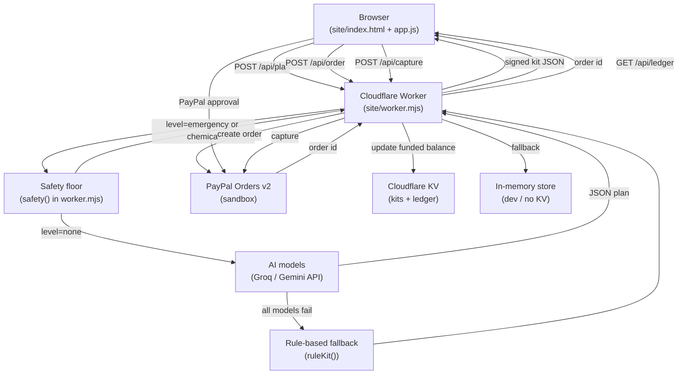

# KhetKit — AI-built farm input kits, funded with PayPal

**Live:** https://khetkit.vercel.app (Vercel) · mirror: https://khetkit.sites.tab.bot


**Live demo:** https://khetkit.sites.tab.bot/ (PayPal **sandbox**; no real money moves)
**Hackathon:** PayPal AI Hackathon 2026 (Devpost) · **Team lead:** Akshay Wagh (Pune, India)
**Disclosure:** Built by Tab, an AI assistant, for team lead Akshay Wagh. AI tools used are listed below.

## Screenshot


## The problem
Smallholder farmers in India often buy the wrong inputs, on credit, from whoever is nearest — and pesticide advice over the counter is a known cause of overuse and poisoning. Meanwhile, people who want to help (family abroad, CSR teams, NGOs) have no simple way to fund *the right thing* for a specific farm.

## What KhetKit does
1. **Need → kit (AI agent).** A farmer (or an extension worker on their behalf) describes the problem in English, Hindi or Marathi. An LLM agent picks 2–7 items **only** from a 25-item vetted catalogue (diagnosis, traps, bio-inputs, certified seed, water and post-harvest tools), sizes them to the area and budget, and explains each in one plain sentence in the farmer's own language.
2. **Safety floor in code, after the model.** Unknown items are dropped, quantities capped, the budget enforced. A poisoning or self-harm message gets emergency numbers (108 / 112 / Tele-MANAS 14416) and **no kit**. Naming a pesticide or asking for a dose adds a KVK expert visit — KhetKit never sells or doses chemical pesticides. Anything sprayed adds a safety kit.
3. **Funding through PayPal.** PayPal Checkout with an **itemised order** (every kit line is a PayPal line item; `custom_id` = kit id). Supporters can fund the whole kit or part of it ($10 / $25); the progress bar and "partially funded" note update after each payment, and the kit stays open until fully funded.
4. **Fulfilment plan.** When funded, the agent groups lines by supplier type (KVK, licensed seed dealer, FPO shop, drip dealer) and prepares supplier payouts, released on delivery confirmation (PayPal Payouts — next step, see roadmap).

## Architecture



**Key design decisions:**
- The model never sees prices it can change; the server recomputes every total.
- The model never outputs anything that is not a catalogue id; `validate()` drops unknowns.
- The safety floor runs server-side, before and after the AI call, so a jailbroken model cannot bypass it.
- `site/money.mjs` is a pure ES module (no DOM) imported by both the front end and the test suite.
- Sample kits are static JSON (`site/samples.json`) and use the same `/api/order` → `/api/capture` flow.

## What is live

PayPal Checkout buttons run in the PayPal sandbox with PayPal's public sandbox client. The server-side Orders v2 path ships but needs merchant sandbox credentials (`PAYPAL_CLIENT_ID` + `PAYPAL_SECRET`) to activate.

## PayPal integration
- **PayPal JavaScript SDK (Buttons)**, `intent=capture`, USD, sandbox.
- **Orders v2**: when `PAYPAL_CLIENT_ID` + `PAYPAL_SECRET` (sandbox REST app) are set, the Worker itself creates the order (`POST /v2/checkout/orders` with `PayPal-Request-Id` idempotency) and captures it (`POST /v2/checkout/orders/{id}/capture`) — the agent transacts server-side. Without them the demo uses PayPal's public sandbox client id (`sb`) and creates the same itemised order in the browser.
- Captures update the kit's funded balance and a public ledger (`/api/ledger`).

## AI models
The exact model IDs used (checked against Groq and Google AI Studio model lists on 1 Nov 2026):

| Priority | Model ID | Provider |
|---|---|---|
| 1 | `openai/gpt-oss-120b` | Groq |
| 2 | `qwen/qwen3.8-27b` | Groq |
| 3 | `openai/gpt-oss-20b` | Groq |
| 4 | `gemini-3.5-flash-lite` | Google Gemini API |
| 5 | Rule-based tag matcher | (no model key needed) |

Model IDs are also returned by `/api/config` at runtime.

## Run it yourself
Cloudflare Worker with static assets (`site/`): entry `site/worker.mjs`, config `site/tab-site.json` (optional KV binding `DATA`).
```
cd site
npx wrangler dev worker.mjs --assets . \
  --var GROQ_API_KEY:<key> --var PAYPAL_CLIENT_ID:<sandbox id> --var PAYPAL_SECRET:<sandbox secret>
```
API: `POST /api/plan {need,crop,acres,budget}` · `POST /api/order {kit_id,kit,amount}` · `POST /api/capture {kit_id,kit,order_id}` · `GET /api/ledger` · `GET /api/config`.
Tests: `node --test test/`.

## Tests

Run with `node --test test/site.test.mjs`. All tests pass on Node 22.

```
TAP version 13
ok 1 - index has title, viewport, disclosure, local assets
ok 2 - catalogue has no chemical pesticides and sane prices
ok 3 - worker carries the safety floor and no secrets
ok 4 - money.mjs: INR_PER_USD is 88
ok 5 - money.mjs: inr() formats USD to ₹ with USD beside it
ok 6 - money.mjs: inr() handles zero and fractional amounts
ok 7 - money.mjs: progress() returns correct funded/remaining/pct
ok 8 - money.mjs: progress() clamps funded to [0, total]
ok 9 - money.mjs: progress() handles zero total without division by zero
ok 10 - worker safety floor: self-harm returns emergency, no kit
ok 11 - worker safety floor: pesticide dose returns chemical level with kvk_consult in kit
ok 12 - worker safety floor: normal need has safety.level=none
ok 13 - samples.json: two sample kits exist and are clearly labelled
ok 14 - index.html: INR footer note present
ok 15 - index.html: safety floor example chips present
ok 16 - money.mjs exists and is importable as an ES module
ok 17 - money.mjs: plural() — singular, plural, fractional
ok 18 - money.mjs: groupBySupplier() groups lines and sums subtotals
ok 19 - i18n: STR table has en/hi/mr keys and t() helper returns strings
ok 20 - index.html: what-is-live line present
# tests 20
# pass 20
# fail 0
```

## Honest limits
- Prices are illustrative; catalogue items are generic categories, not endorsed products.
- ₹ figures use a stated conversion rate of ₹88 per US$, approximate, as of 1 Nov 2026; the PayPal sandbox currency is USD.
- The kit is not a diagnosis; the KVK visit exists for that reason.
- Without KV storage the kit is carried by the browser and HMAC-signed so lines and prices cannot be edited.

## Roadmap
PayPal Payouts to suppliers on delivery confirmation (photo + OTP from the farmer), Venmo/Pay Later for supporters, WhatsApp intake for farmers, KVK dashboard.

MIT licence.
